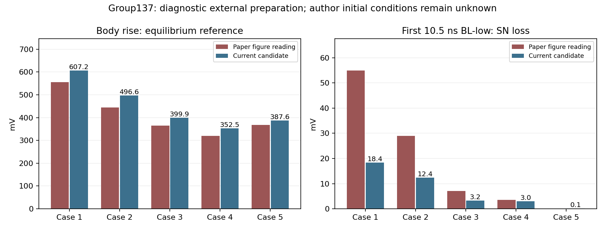

# 조건 조합 시뮬레이션 현황 — 2026-10-07 09:15

## 한 줄로

720개 중 431개 결과를 확보했어요. 아직 다섯 Case와 쓰기를 모두 만족하는 공통 후보는 없어요. 확인 시각은 2026-10-07T09:15:15.162555+09:00예요.

## 기본부터

기존20개와 신규 완료411개를 분석했어요. 8개가 실행 중이고, 281개가 대기 중이에요. 분석 실패는 0개이고 큐 로그의 ERROR는0개였어요. 현재8개 실행의 부분 출력도 모두 형식 검사를 통과했어요. 이는 서버와 출력이 정상이라는 뜻이며 논문 재현 성공을 뜻하지 않아요.

## 조금 더

다섯 Case가 모두 끝난 공통 조합은 85개예요. 현재 가장 가까운 후보는 group137예요. SN쪽25nm 대리 생성, 기존GBQ×1.25, 유지21ns, SN clamp후하강0.5ns전에해제, II켬, 기존쓰기보정Cs예요. 국소 source는 명목 dose를 맞추기 위해 부피비5배를 별도로 적용했어요. 이 값은 저자의 명시 조건이 아니에요.

| Case | 하강 전 정공 [개] | 몸체 상승: 논문 / 계산 [mV] | 첫 low 손실: 논문 / 계산 [mV] |
|---|---:|---:|---:|
| 1 | 1287 | 555 / 607.2 | 55 / 18.37 |
| 2 | 1258 | 445 / 496.6 | 29 / 12.41 |
| 3 | 1239 | 365 / 399.9 | 7.1 / 3.22 |
| 4 | 1090 | 320 / 352.5 | 3.5 / 2.96 |
| 5 | 1216 | 368 / 387.6 | 0 / 0.13 |

몸체 전위는 중앙 electrostatic potential의 평형 대비 상승이에요. 저자의 위치와 기준은 미확인이므로, 그림에 잘 맞는 정의를 골라 저자의 정의라고 확정하지 않아요. 첫 low 목표는 Fig8 곡선 판독값이며 200ns 누적 손실과 다른 항목이에요.

## 그래서?

SN쪽 국소 준비는 공통 최대 오차 점수를 기존2.26에서1.74로 줄였어요. 통과 기준은1이하예요. Case3·4는 가까워졌지만 Case1·2 손실은 각각 약3배·2.3배 작아요. 정공 수 하나만 맞추는 방식으로는 충분하지 않다는 결과예요.

이 후보의 첫 low 전하 수지는 다섯 Case 모두 허용치 이내예요. 다만 Case2 쓰기곡선의 최대 개별 오차는63.4mV로 진단 기준30mV를 넘어요. 쓰기까지 재현되었다고 확정하지 않아요.

자연 생성·자유 SN 유지 조건은 완료30개 중 동시 기준을 통과한 것이 없어요. 외부 clamp 또는 대리 생성으로 맞춘 결과를 자연적인 GIDL 정공 축적의 재현으로 바꾸어 해석하지 않아요.

현재 구조·도핑·재료·Hurkx/II 계수는 이번 배치에서 바꾸지 않았어요. 실행 전 본문·figure와 실제 mesh 점검 기록을 유지해요. 지금은 첫 low10.5ns 선별 단계예요. 전체200ns, Id–Vg, 쓰기와 필요한 몸체 접지 대조 검증은 후보 선택 뒤의 남은 작업이에요.

## 자료와 숫자의 근거

- 완료/실행: 같은 시각 서버 status.json, queue.log 및 ranking.json을 읽었어요.
- 논문 값: 사용자 보유 Cho IRPS2026 본문과 Fig8 판독값이에요. [DOI](https://doi.org/10.1109/IRPS61424.2026.11499232).
- 허용치: 몸체±30mV, 첫 low±0.3decade/Case5 1mV, SN초기와유지±5mV, 쓰기각점±30mV는 진단용 기준이며 논문 명시 오차가 아니에요.
- 설명 방식: [eliU](https://github.com/leejinseok08/eliU/blob/bab1664d148c4fa156403807af9172d8fa07c70c/SKILL.md).

## 용어 풀이

| 용어 | 뜻 |
|---|---|
| 공통 후보 | 같은 준비 방식과 모델 선택을 Case1~5에 적용한 조합이에요. |
| 대리 생성 | 초기 정공 분포를 진단하기 위한 외부 pair-generation source예요. |
| 전하 수지 | 자유 SN에서 전류 적분과 CsΔV가 맞는지 확인해요. |
