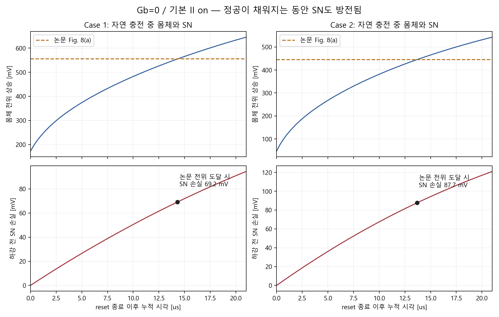

# Cho IRPS2026 재현: 라운드 11 원인 분석과 복구 현황

작성 방식: [eliU](https://github.com/leejinseok08/eliU/blob/bab1664d148c4fa156403807af9172d8fa07c70c/SKILL.md). 실제 용어를 유지하고, 회로이론과 반도체 소자의 기본식으로 설명해요.

## 한 줄로

**유지 시간을 늘리면 몸체에 정공이 쌓여요. 하지만 그동안 저장 노드(SN) 전압도 내려가요. 그래서 현재 조건에서는 몸체 전위와 SN 손실을 함께 재현하지 못했어요.**

손상된 Codex 출력은 검사한 19개 중 2개예요. 그중 FBE Case 2는 복구가 끝났어요. 나머지 복구와 생성·재결합을 읽는 보완 계산을 진행하고 있어요.

## 기본부터

### SN 손실은 커패시터 전하 감소예요

저장 노드(storage node, SN)는 데이터를 전압으로 저장해요. 저장 용량을 Cs라고 해요. 회로이론의 **Q = Cs × V_SN**을 그대로 사용해요.

전하가 빠져나가면 SN 전압이 내려가요. 이 보고서의 전압 손실 ΔV_SN은 양수로 표시해요. 단자에서 빠져나간 전하도 전류 적분으로 구해요.

**∫ I_SN dt ≈ Cs × ΔV_SN**

I_SN은 SN에서 소자 쪽으로 흐르는 총전류예요. 왼쪽은 전류로 계산한 전하예요. 오른쪽은 전압으로 계산한 전하예요. 같은 구간의 두 값이 가까워야 분석을 신뢰할 수 있어요.

### 정공 생성과 정공 축적은 달라요

부유 몸체(floating body)는 전위를 직접 고정하지 않은 몸체예요. 여기 쌓인 정공 수를 Nh라고 해요. 정공은 생성되지만, 재결합하거나 경계를 넘어 이동할 수도 있어요.

따라서 **생성한 정공 수와 남아 있는 Nh는 달라요.** KCL처럼 몸체에 들어오고 나가는 전하를 계산해야 해요.

**ΔNh = N_BTBT + N_II − N_SRH − N_out**

ΔNh는 구간 전후의 정공 수 차이예요. N_BTBT와 N_II는 각 모델의 생성률 적분이에요. N_SRH는 순재결합률 적분이에요. N_out은 몸체 경계를 통한 순유출이에요. 각 항은 같은 몸체 영역에서 계산해야 해요.

BTBT(band-to-band tunneling)는 밴드 사이 터널링이에요. 전자·정공을 만들거나 역과정에 기여할 수 있어요. GIDL(gate-induced drain leakage)은 게이트와 드레인 쪽 전계로 생기는 누설이에요. 현재 GIDL에는 Hurkx라는 BTBT 모델을 사용해요.

충돌 이온화(impact ionization, II)는 고에너지 캐리어가 전자·정공을 만드는 과정이에요. SRH(Shockley–Read–Hall)는 결함 준위를 통한 생성·재결합 모델이에요. 이번 signed SRH 출력은 순재결합이에요. 음수면 순생성이에요.

### 몸체 전위가 올라도 재현 완료는 아니에요

몸체 전위가 바뀌면 MOSFET의 body effect가 달라져요. BL이 내려갈 때는 접합 바이어스도 달라져요. 기생 BJT(parasitic BJT)는 소자 내부 n+–p–n+가 만드는 BJT예요. 저자는 정공 축적과 이 BJT로 전류 스파이크를 설명해요.

이 설명을 확인하려면 여러 결과가 함께 맞아야 해요. 하강 직전의 Nh, 몸체 전위, SN 전압이 필요해요. 하강 뒤 전류와 SN 손실도 확인해야 해요. **현재 결과만으로 기생 BJT 설명을 재현했다고 확정하지 않아요.**

## 조금 더

### 1. 논문 전위에 도달했을 때 SN을 확인했어요

Claude 라운드 11은 대리 생성 없이 기다리는 실험이에요. 대리 생성은 초기 정공을 맞추려고 별도로 넣던 전자·정공 생성 항이에요. 이번에는 그 항을 0으로 했어요.

유지 시간과 BL 주기는 21 µs부터 21 ms까지예요. 논문의 ns 파형보다 길어요. 자연 생성으로 몸체를 채울 수 있는지 확인하는 진단이에요.

21 µs 실험에서 논문 막대 높이에 처음 도달한 순간을 찾았어요. 다음 시간과 SN 손실은 시뮬레이션 출력의 선형 보간값이에요. 논문 전위는 Fig. 8(a)의 그림 판독값이에요.

| Case | 논문 몸체 전위 상승 [mV] | 도달 시각 [µs] | 그때 몸체 정공 수 [개] | 그때 SN 유지 손실 [mV] |
|---|---:|---:|---:|---:|
| 1.00 | 555.00 | 14.32 | 1088.70 | 69.18 |
| 2.00 | 445.00 | 13.68 | 1060.94 | 87.65 |
| 3.00 | 365.00 | 18.12 | 1102.58 | 109.62 |
| 4.00 | 320.00 | 17.67 | 964.43 | 96.47 |
| 5.00 | 368.00 | 13.34 | 1140.63 | 114.48 |

Case 1은 약 14.3 µs에 논문 전위에 도달해요. 하지만 SN은 이미 약 69.2 mV 내려갔어요. Case 2도 약 13.7 µs에 도달해요. 그때 SN 손실은 약 87.7 mV예요.

**정공을 채우는 동안 초기 SN 상태도 바뀌는 게 문제예요.** 논문처럼 SN이 유지된 상태를 동시에 만들지는 못했어요. 몸체 전위의 측정 위치와 기준도 저자에게 확인해야 해요.

그림: 위의 실선은 현재 시뮬레이션 전위예요. 점선은 논문 Fig. 8(a)의 높이예요. 아래 검은 점은 두 전위가 같아지는 순간이에요. 그 순간에도 SN이 이미 내려갔는지 보세요. 전위는 현재 평형 상태를 기준으로 표시했어요. 데이터는 Dz3F_c1 / Dz3F_c2의 저장 출력이에요.

### 2. SN 전하 감소와 정공 축적이 함께 관측됐어요

21 µs 유지 구간의 Case 1을 계산했어요. SN 총전류 적분은 약 0.2075 fC예요. 전압으로 계산한 CsΔV는 약 0.2065 fC예요. 두 값의 차이는 약 0.50%예요.

전자 한 개의 전하량은 약 1.602×10⁻¹⁹ C예요. 따라서 0.2075 fC는 전자 약 1295개의 전하량이에요. 같은 구간에서 몸체 정공은 약 1349개 늘었어요. 전하량의 규모가 비슷해요.

SN 단자에서는 전자 전류가 대부분이에요. 현재 출력은 **SN 전하 감소와 몸체 정공 축적이 함께 일어남**을 보여줘요. 하지만 숫자가 비슷하다는 이유만으로 같은 경로라고 확정하지 않아요. 경계 이동과 생성·재결합을 더 읽어야 해요.

전체 Si에서 적분한 BTBT는 약 1229쌍이에요. II는 약 126쌍이에요. 둘 다 시뮬레이션값이에요. II도 켜져 있으므로 모두 GIDL이라고 부르면 안 돼요.

그리고 전체 Si는 몸체보다 넓은 영역이에요. 여기의 생성량에서 몸체 Nh 증가를 빼면 영역이 섞여요. 그 차이를 재결합이라고 부를 수 없어요.

### 3. 첫 low 손실은 시간 구간을 맞춰야 해요

BL(bitline)은 셀을 읽고 쓰는 배선이에요. 첫 low는 BL이 처음 내려간 구간이에요.

21 µs 주기의 첫 low 전체 길이는 10.5 µs예요. 논문 비교에 사용하는 첫 10.5 ns보다 1000배 길어요. 그래서 두 손실을 따로 계산했어요.

Case 1의 첫 low 전체 손실은 약 334.5 mV예요. 첫 하강 뒤 10.5 ns만 보면 약 46.5 mV예요. 같은 실험에서 나온 값이지만 비교 구간이 달라요.

일부 값이 논문과 가까워 보일 수 있어요. 하지만 하강 전 SN과 몸체 전위도 같아야 해요. **손실 값 하나만 가까워진 것은 재현 성공이 아니에요.**

### 4. 기존 출력만으로 재결합을 확정할 수 없어요

기존 라운드 11에는 몸체 내부 SRH 적분이 없어요. 전류 적분의 수치 오차도 확인했어요. 21 µs Case 1·2의 긴 첫 low에서는 CsΔV와 약 8.31%·7.20% 차이가 나요.

시간 간격이 크면 급한 전류 변화를 놓칠 수 있어요. 그래서 두 가지를 보완했어요. 같은 몸체 영역의 생성·SRH를 출력해요. BL 하강 근처의 계산 시간 간격도 줄여요.

NG_c1_21us와 NG_c2_21us가 이 보완 실험이에요. 원래 mesh, 재료, 모델 계수, Cs, 바이어스는 유지해요. mesh는 TCAD에서 소자를 계산점으로 나눈 격자예요. 관측 항목과 수치 해상도만 바꿨어요.

몸체 hDensity와 eDensity로 정공·전자 수를 읽어요. 몸체 BTBT, II, signed SRH도 적분해요. SN과 BL의 전자·정공·총전류는 따로 읽어요. 첫 하강 edge, low plateau, 첫 10.5 ns를 구분해요.

순유출은 전하 보존식의 잔차로 추정해요. 잔차에는 수치 오차도 포함돼요. **직접 측정한 몸체 경계 전류라고 보고하지 않아요.** SRH 출력도 순재결합이므로 총생성과 총재결합을 각각 안다고 말하지 않아요.

#### 보완 계산에서 읽힌 첫 결과

Case 1의 첫 하강 전 21 µs 구간이 저장됐어요. 계산 전체는 아직 진행 중이에요. 아래는 이 유지 구간만의 결과예요.

| 관측량 | 값 | 의미 |
|---|---:|---|
| SN 유지 손실 | 94.770 mV | 기존 94.477 mV와 약 0.293 mV 차이 |
| 몸체 정공 증가 ΔNh | 1353.271개 | 몸체에 남은 정공의 증가 |
| 몸체 BTBT 적분 | 856.241쌍 | 몸체 안의 BTBT 항 |
| 몸체 II 적분 | 115.875쌍 | 몸체 안의 충돌 이온화 항 |
| 몸체 SRH 순재결합 적분 | -0.000219쌍 | 거의 0, 음수는 순생성 |
| 순유출·수치 오차 잔차 | -381.154개 | 음수이므로 순유입 또는 수치 오차 기여 |
| SN 전류 적분과 CsΔV 차이 | 0.107% | SN 전하 계산의 일치 정도 |

시간 해상도를 높여도 SN 손실이 유지돼요. 따라서 이 유지 손실은 기존의 거친 출력만으로 생긴 현상은 아니에요.

몸체 안의 BTBT와 II를 합하면 약 972쌍이에요. 하지만 몸체 정공은 약 1353개 늘었어요. SRH 순재결합은 거의 0이에요. 나머지를 재결합으로 해석하면 부호부터 맞지 않아요.

몸체 밖에서 생성된 정공의 유입이 한 후보예요. 영역 적분의 수치 오차도 남아 있어요. 아직 직접 측정한 경계 전류는 없어요. 따라서 유입 경로와 양은 확정하지 않아요. 이 결과는 **몸체 정공 수를 몸체 내부 생성량만으로 설명하면 안 됨**을 보여줘요.

전체 Si의 BTBT·II 적분은 약 1354.7쌍이에요. 몸체 내부보다 약 382.6쌍 많아요. 이 차이는 위 잔차의 크기와 가까워요. **몸체 밖 생성 정공의 유입이라는 설명과 일관된 결과**예요. 다만 직접 경계 전류를 읽은 결과는 아니므로 추론으로 표시해요.

### 5. 손상된 출력 두 개만 복구해요

Codex의 조건 분리와 FBE A1/A2/A3를 검사했어요. 범위는 19개 실행이에요. 모든 과거 파일을 검사했다는 뜻은 아니에요.

종료 코드가 0이어도 출력은 손상될 수 있어요. 그래서 숫자 형식, 행·열, 시간축을 확인했어요. 마지막 시각과 요청 출력 누락도 검사했어요. 17개는 통과했고 2개는 손상됐어요.

| 원래 실행 | 확인한 손상 | 복구 방법 |
|---|---|---|
| CDR_id_i0_idle | sys 숫자 잘림, dev 시간축·행 이상 | 출력 이름만 바꿔 동일 덱 재실행 |
| FS_c2_q1300 | sys/dev PLT 없음 | 출력 이름만 바꿔 동일 덱 재실행 |

PLT는 시간별 수치를 저장하는 결과 파일이에요. 덱(deck)은 소자·모델·바이어스를 적은 실행 입력이에요. 원래 손상 파일은 보존해요. 빠진 값을 보간해 완료 결과로 만들지 않아요.

FS_c2_q1300은 약 1300개를 넣는 기존 대리 생성 진단이에요. 복구 결과는 유지 손실 48.09 mV예요. 첫 low 추가 손실은 15.51 mV예요. 자연 생성 라운드 11과 다른 실험이에요.

### 6. 실행 전에 원문과 실제 mesh를 다시 점검했어요

Cho 논문의 본문과 Figs. 2/4/5/6/7/8을 다시 확인했어요. 실제 mesh에서 접합·도핑·몸체 경계를 다시 읽었어요. 12개 수평 cutline과 4개 수직 검사가 통과했어요. cutline은 지정한 선을 따라 소자값을 읽는 방법이에요.

| 값 | 현재 사용하는 값 | 출처·판정 |
|---|---|---|
| Gate length Lg | 100 nm | 논문 Fig. 5 관련 공개값 대조 |
| Tox / gate metal thickness / dVOX | 5 / 20 / 30 nm | 논문 공개 치수 대조 |
| Case 1 / 2 body thickness | 30 / 20 nm | 논문 공개 치수·실제 mesh 대조 |
| Nsd / Nch | 1×10²⁰ / 1×10¹⁸ cm⁻³ | 논문 공개 도핑·실제 mesh 대조 |
| Gate work function | 4.7 eV | 논문 공개값 대조 |
| Gate dielectric / spacer | HfO2 / Si3N4 | 현재 가정, 저자 명시 재료 미확인 |
| Junction profile / temperature | abrupt / 300 K | 현재 가정, 저자 조건 미확인 |
| Case 1 / 2 Cs | 약 2.186 / 1.800 fF | 쓰기 보정값, 저자 명시 Cs로 취급하지 않음 |
| GIDL 모델 | 기존 보정 Hurkx parameter 파일 | 저자 계수 아님, 기본값이라고 부르지 않음 |
| FBE의 II 사용 여부 | 현재 켬 | 논문 Fig. 8 사용 여부 미확인 |
| 몸체 전위 기준·위치 | 평형 기준, x=125 nm 몸체 중앙 | 현재 정의, 저자 정의 미확인 |

자연 생성이라는 말도 주의해야 해요. 라운드 11은 대리 생성 항을 쓰지 않아요. 하지만 기존 보정 Hurkx 계수는 사용해요. 파일은 sdevice_cal_a1.7e21_b2.25e07.par예요. **자연 생성은 무보정 모델이라는 뜻이 아니에요.**

이번 NG 실행도 그 parameter 파일을 유지해요. II는 기존 vanOverstraeten 기본 계수를 유지해요. 구조 검사는 공개 정보와 현재 구현의 대조예요. 미확인 저자 조건까지 일치했다는 뜻은 아니에요.

## 그래서?

현재는 유지 시간만 더 늘리는 방법을 해답으로 확정하지 않아요. 먼저 NG 보완 계산의 전하 수지를 확인해요. 정공이 얼마나 생성되고 재결합하는지 분리해요. SN 손실과 전류 적분의 차이도 확인해요.

수치 해상도를 높여도 결과가 같으면 조건 문제를 검토해요. 초기 몸체 상태, SN 초기화, 저자의 전위 정의가 남아 있어요. Fig. 8의 II 사용 여부도 확인해야 해요. 지금은 논문 근거 없이 구조나 계수를 새로 바꾸지 않아요.

서버에서는 Codex 계산을 최대 2개만 동시에 실행해요. 사용자 저장 공간 한도도 매번 확인해요. Claude의 덱과 실행은 수정하거나 중단하지 않았어요.

실행 상태 확인: **2026-10-06T21:55:14.895392+09:00**.

| 실행 | 상태 | 저장된 마지막 시각 [ns] |
|---|---|---:|
| RR_CDR_id_i0_idle | 실행 중 | 8.97 |
| RR_FS_c2_q1300 | 복구 완료·출력 검사 통과 | 63.14 |
| NG_c1_21us | 실행 중 | 21000.82 |
| NG_c2_21us | 대기 | — |

Case 1 보완 계산에서 몸체 BTBT·II·SRH를 읽었어요. 첫 하강 전 유지 구간은 위 표에 반영했어요. 보완 계산 전체는 아직 완료되지 않았어요. 첫 BL-low의 전하 수지와 재결합은 후속 검증이 필요해요.

## 출처와 숫자 종류

- 원문: Cho 외, *Row Hammer Effect and Floating Body Effect of Monolithic 3D Stackable 1T1C DRAM*, IRPS 2026, [DOI](https://doi.org/10.1109/IRPS61424.2026.11499232). 사용자 보유 본문과 figure를 재검토했어요.
- GIDL–정공–기생 BJT 설명: Lee 외, *Monolithically Stackable 1T1C 3-D DRAM: A Technical Survey*, Sec. II-B / Fig. 3. 설명은 모델 계수를 확정하지 않아요.
- Claude 소스: vblhwl-3d-dram의 claude commit 9ff69e649740843eb39be74d093f5cc5bc36bd38과 서버 라운드 11의 실제 CMD/PLT예요.
- 라운드 11 분석 시점: **2026-10-06T21:33:41.373818+09:00**. 20개 중 11개는 전체 완료예요. 나머지는 부분 출력이에요. 아래 첫 low 구간은 20개 모두 저장돼 있어요.
- `audit_round11.json`과 `round11_phase_results.csv`에 전체 20개 조건을 보관했어요. 전류 적분은 저장 샘플의 사다리꼴 적분이에요. 논문 전위 도달 시점은 선형 보간이에요.
- `PRE_RUN_CHECK.md`, `manifest.json`, `checks/`에는 실행 전 구조·원문 점검을 보관했어요. 초기 17:54 공유 스냅샷과 별도의 후속 검토예요.

## 핵심 수치표

21 µs 유지 / 21 µs BL 주기의 시뮬레이션값이에요. 전위 상승은 현재 평형 기준이에요. 첫 low 전체는 10.5 µs예요. 첫 10.5 ns 손실과 구분해서 읽으세요.

| Case | 하강 직전 Nh [개] | 몸체 전위 상승 [mV] | 하강 전 유지 손실 [mV] | 첫 low 전체 손실 [mV] | 첫 10.5 ns 손실 [mV] |
|---|---:|---:|---:|---:|---:|
| 1.00 | 1451.76 | 645.40 | 94.48 | 334.46 | 46.53 |
| 2.00 | 1453.89 | 542.59 | 120.99 | 239.60 | 34.99 |
| 3.00 | 1247.51 | 400.87 | 124.08 | 76.57 | 3.27 |
| 4.00 | 1116.95 | 358.39 | 111.69 | 62.28 | 3.39 |
| 5.00 | 1694.89 | 500.79 | 169.84 | 66.54 | 0.13 |

## 용어 풀이

| 용어 | 이 보고서에서의 뜻 | 현재 값·출처 |
|---|---|---|
| SN / Cs | 데이터를 저장하는 노드 / 저장 용량 | 현재 Cs는 쓰기 보정값 |
| BL / WL | 읽기·쓰기 배선 / 게이트 제어 배선 | 라운드 11 PWL 바이어스 |
| Floating body | 전위를 직접 고정하지 않은 몸체 | 현재 R.Ch_v 영역 |
| Nh | 몸체에 남은 정공 수 | hDensity 적분 × 실제 2D 폭 |
| FBE | 부유 몸체의 전하가 소자 특성을 바꾸는 효과 | Fig. 8 동시 재현 미완료 |
| BTBT / GIDL | 밴드 간 터널링 / 게이트·드레인 전계에 의한 누설 | 기존 보정 Hurkx 사용 |
| II | 고에너지 캐리어에 의한 전자·정공 생성 | 이번 FBE 진단은 켬 |
| SRH | 결함 준위를 통한 순생성·순재결합 | NG에서 몸체 적분 추가 |
| First low | BL이 처음 내려간 뒤 낮게 유지되는 구간 | 이번 전체 구간 10.5 µs |
| Time step | 과도 계산의 시간 간격 | BL edge 근처 5 ps 이하 |
| 전하 수지 잔차 | 생성−순재결합−몸체 정공 증가 | 경계 이동과 수치 오차가 섞임 |
| 재현 완료 | 관련 조건과 결과가 함께 맞는 상태 | 현재 미완료 |
