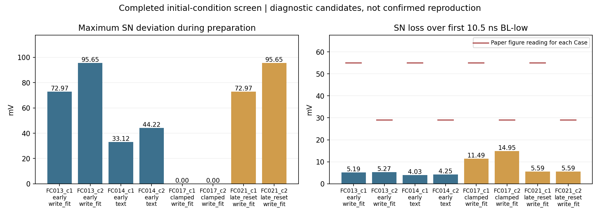

# 조건 조합 실험 등록과 후보 탐색 — eliU

## 한 줄로

논문 구조는 유지하고, 미확인 초기 상태를 조합해요. **720개 후보 중 기존 완료20개는 재분석하고, 새700개를 계산해요.** 후보 순위는 몸체 전위·SN 유지·첫 손실을 함께 기준으로 해요. 상태 확인은 2026-10-06T23:44:15.235693+09:00예요. 신규 완료8개, 실제 실행 중8개예요. 후보는 계산 완료와 검증 후 갱신해요.

이 등록은 Claude의 `claude/EXPERIMENTS.md`를 수정하지 않는 Codex 후속 등록이에요. Claude 최신 f02df0f와 서버를 확인했어요. Claude 신규 실행은 없고 기존 Codex NG/복구4개는 모두 완료·출력 검증을 마쳤어요.

## 기본부터

몸체에 남는 정공 수는 생성량과 달라요. 생성·재결합·몸체 경계 이동을 함께 읽어야 해요. SN은 커패시터이므로 빠져나간 전하는 Cs×전압 감소예요. 그래서 전류 적분과 CsΔV도 함께 확인해요.

SN을 외부에서 고정하면 전하를 보충할 수 있어요. 이 상태에서 그림을 맞춘 결과와 자유로운 자연 이력은 구분해야 해요. 후보 표의 `classification`에 그 차이를 기록해요.

## 이번에 조합하는 값

| 축 | 후보 | 개수 |
|---|---|---:|
| 소자 | 논문 Case1~5의 gr 단면 | 5 |
| 자연 정공 준비 | 유지21ns /15.2µs /21µs, 대리 생성0 | 3 |
| 대리 정공 준비 | uniform/BL쪽25nm/SN쪽25nm × 기존GBQ의1/1.125/1.25배 | 9 |
| SN 초기화 | 초기10ps만고정/BL하강0.5ns전까지고정/초기자유후하강직전10ps재설정 | 3 |
| 충돌 이온화 | 현재계수켬 / 끔 | 2 |
| Cs | 본문5.1/4.2/3.6fF / 쓰기보정×1.8/4.2 | 2 |

정공 준비12종에 나머지 축을 곱하면720개예요. 연속값의 모든 경우를 조사했다는 뜻은 아니에요. 기존GBQ는 약1050개를 준비하던 보정 생성률이에요. 1.125배는 막대·손실용 전하 사이의 중간 후보예요. 실제 정공 수는 결과에서 읽어요. 25nm source에는 명목부피비5배를 적용해요. 실제 생성 적분이 같은지도 확인해요.

모든 후보의 첫 BL-low는 **10.5ns**로 맞춰요. 긴 유지 뒤에도 BL 주기는 논문의21ns예요. 기존 라운드11의 긴 BL 주기와 다른 실험이에요. 기존NG와 동일한첫10.5ns는 결과를 재활용해요.

## 고정하는 것과 점검

Lg100/Tox5/Tgm20/dVOX30nm, 접합50/175nm, Nsd1e20cm⁻³, Case별몸체30/20/10nm·Nch1e18/1e16·WF4.7/5.0eV는 고정해요. HfO2/Si3N4,300K,SRH수명과기존Hurkx보정값은 현재 가정으로 유지해요. 소재·접합·계수배수는 이번 축에 넣지 않아요.

Cho 본문 III/IV/VI와 Fig2/4/5/8 및 Fig7을 다시 확인했어요. 실제mesh horizontal12개와vertical4개, opticalsource12개 검사가 모두 통과했어요. 모든PASS줄을읽었어요. 입력해시와원문검토기록은 `PRE_RUN_CHECK.md`/`checks/reviewed.json`에 보관했어요.

몸체 전위 정의는 시뮬레이션 축이 아니에요. 같은 결과에서 중앙/BL스페이서/게이트/SN쪽 전위와정공준페르미전위를읽어요. 평형기준과초기reset종료기준을모두기록해요. 가장잘맞는정의를저자정의라고선택하지않아요.

## 어떻게 후보를 고르나요?

| 조건 | 비교 기준 | 숫자 종류 |
|---|---|---|
| 몸체 전위 상승 | Fig8(a)555/445/365/320/368mV, 오차30mV | 그림판독값/현재허용치 |
| 첫low손실 | 55/29/7.1/3.5/0mV, 0.3decade·Case5 1mV | 그림판독값/현재허용치 |
| 하강직전SN와유지평탄도 | 1.1V 및5mV | 논문바이어스/진단허용치 |
| 첫low전하수지 | ∫I와CsΔV 차이≤max(1%,1e-4fC) | 수치검증허용치 |
| Case2쓰기 | 12/24/39/60ps에서0.72/0.92/1.06/1.13V, 개별30mV | Fig4판독값/현재허용치 |

각오차를허용치로나눠요. 그중 **가장큰오차**를순위에써요. 평균오차만좋아서큰실패를가리는경우를피하기위해서예요. 같은조건의5Case가모두계산된그룹은공통후보순위를따로만들어요. Case별맞춤값을하나의공통조건이라고합치지않아요.

완료20개를엄격하게재평가한결과, 모든조건을통과한공통후보는아직없어요. 기존GBQ1.25배가첫손실에더가깝지만몸체전위가높아요. 최선의공통점수도약2.26이고통과기준은1이에요. `candidate_ranking.csv`는가까운후보표이며재현성공표가아니에요.

상위후보는200ns전체곡선과IdVg·쓰기·필요한접지대조로재검증해야해요. 초기전하를외부조건으로넣은후보는정공이자연스럽게생기는과정까지재현한것이아니에요. 720개screen후좋은후보주변값을더촘촘히확인해요.

## 실행과 자료

서버자원은128CPU,available약240GB였어요. 8개동시실행,각4threads로계산해요. 새실행전마다512MiBquota여유와입력동일성을검사해요. 완료한자체로그·PLT·TDR는해시검증후무손실압축해요. 다른작업은수정·중단하지않아요. 신규screen은6h가넘으면그실행만수렴실패후보로기록해요.

- 원격배치: `/home/e20241515/vblhwl_3d_dram/codex_validation/factorial_conditions_20261006`.
- `design_matrix.csv`: 전체720개조건.
- `reuse.json`: 중복실행하지않는기존20개조건.
- `candidate_ranking.csv`/`ranking.json`: 완료결과와Case별·공통후보순위. 새결과마다서버에서갱신해요.
- `results/<run>.json`: 정공수·전위·SN·생성·순재결합·전류적분·외부보충전하.
- 보고서방식: [eliU](https://github.com/leejinseok08/eliU/blob/bab1664d148c4fa156403807af9172d8fa07c70c/SKILL.md).
- 원문: Cho IRPS2026, [DOI](https://doi.org/10.1109/IRPS61424.2026.11499232), 사용자보유본문/figure. Lee survey SecII-B/Fig3의GIDL정공→기생BJT설명은계수값을확정하지않아요.

## 용어 풀이

| 용어 | 뜻 |
|---|---|
| GBQ | 기존막대상태에맞춘대리pair-generation rate |
| 초기이력 | 첫BL하강전에소자가겪은쓰기·유지·reset과정 |
| clamp | SN전압을외부에서고정하는조건 |
| factorial screen | 지정한이산후보의모든조합을계산하는1차시험 |
| 후보 | 여러결과에가까운입력조합, 저자조건확정값은아님 |

## 새로 완료된 결과

신규 8개가 출력 검증을 통과했어요. 아래 전위는 중앙 electrostatic potential의 평형 대비 상승이에요. 저자의 측정 위치와 기준은 아직 확정되지 않았어요.

| Run | Case | SN 준비 / Cs | 하강 전 정공 [개] | 몸체 상승 [mV] | 유지 중 최대 SN 편차 [mV] | 첫 low 손실 [mV] | 첫 low 전하 수지 오차 [%] |
|---|---:|---|---:|---:|---:|---:|---:|
| FC013_c1 | 1 | early / write_fit | 1143.2 | 569.1 | 72.975 | 5.19 | 0.0263 |
| FC013_c2 | 2 | early / write_fit | 1155.8 | 469.3 | 95.651 | 5.27 | 0.0151 |
| FC014_c1 | 1 | early / text | 1205.8 | 585.9 | 33.121 | 4.03 | 0.0025 |
| FC014_c2 | 2 | early / text | 1229.1 | 488.7 | 44.222 | 4.25 | 0.0077 |
| FC017_c1 | 1 | clamped / write_fit | 1228.2 | 592.3 | 0.002 | 11.49 | 0.0019 |
| FC017_c2 | 2 | clamped / write_fit | 1284.3 | 503.2 | 0.003 | 14.95 | 0.0152 |
| FC021_c1 | 1 | late_reset / write_fit | 1143.2 | 570.6 | 72.975 | 5.59 | 0.0185 |
| FC021_c2 | 2 | late_reset / write_fit | 1155.8 | 470.8 | 95.651 | 5.59 | 0.0102 |

Case2 첫 low 목표는 Fig8 판독 약29mV예요. 자연 유지 조건에서 정공 수만 근접해도 SN 초기 상태와 첫 low 손실이 같이 맞지는 않았어요. clamp는 외부에서 전하를 보충하는 준비 조건이에요. late_reset은 유지 중 손실을 되돌리는 외부 조작이며 자연 이력을 재현한 것으로 채택하지 않아요.

**전하 수지 해석:** 첫 low에서 자유로운 SN의 ∫I와 CsΔV를 비교해요. clamp 동안의 차이는 외부 공급 전하가 있으므로 수치 오류로 판정하지 않아요. Set으로 전압을 순간 재설정한 이력은 그 점프 전하가 단자 전류 적분에 모두 잡힌다고 가정하지 않아요. BTBT·SRH 적분은 부호 있는 순생성·순재결합이에요. 몸체 연속식 잔차는 경계 전류와 이산화 오차를 포함하고, 경계 전류를 직접 측정한 값은 아니에요.

